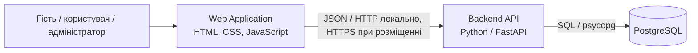
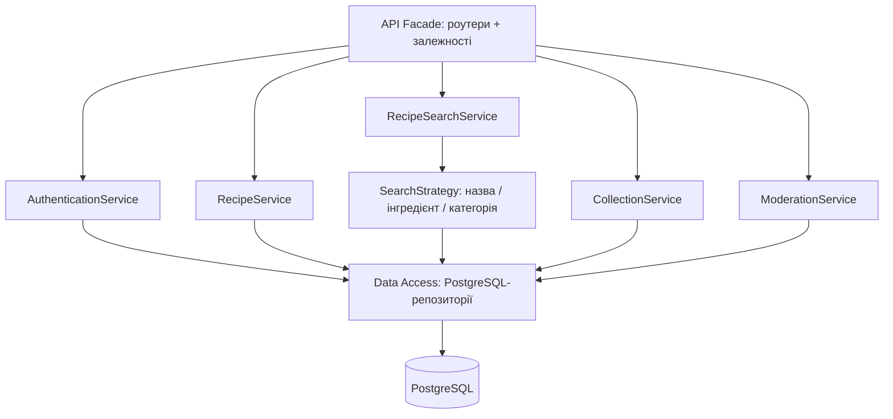
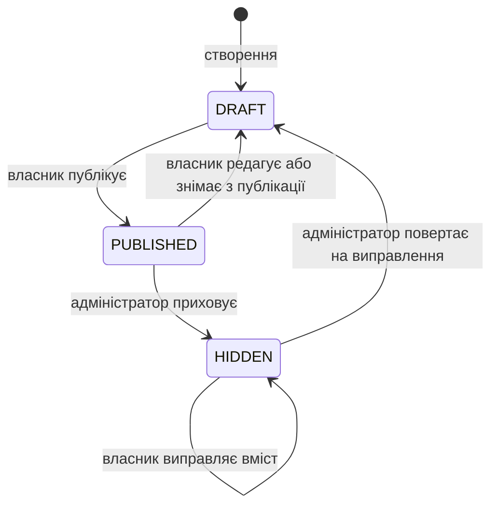

# Архітектура системи організації кулінарних рецептів

Дата: 05.10.2026. Версія: 1.0. Призначення: специфікація для реалізації навчального застосунку.

Статус на 06.10.2026: усі вісім етапів реалізовано в `recipe-app`. Актуальні команди запуску наведено в [README](../recipe-app/README.md), результати завершальної перевірки — у [звіті](../recipe-app/docs/verification.md).

## 1. Основне рішення

Застосунок буде модульним монолітом на Python/FastAPI з PostgreSQL і вебінтерфейсом на HTML, CSS та JavaScript. Один сервер віддає HTML-сторінки, статичні файли та JSON API. Інтерфейс і API працюють на одному origin.

Основою є `Lab_2_Звіт_Система_організації_кулінарних_рецептів.docx`. Зберігаються сутності, компоненти та патерни з лабораторної. Цей документ уточнює рішення, яких бракує для написання коду: API, схему даних, права, переходи станів, транзакції, структуру файлів і перевірки.

Рівень складності відповідає студентському проєкту: є повний цикл роботи з рецептами, користувачі, колекції, модерація та реальне застосування ООП. Усі компоненти виконуються в одному процесі бекенду. Поділ на модулі потрібний для зрозумілого коду.

## 2. Межі першої версії

| Частина | Що реалізуємо |
|---|---|
| Обліковий запис | Реєстрація, вхід, вихід, поточний користувач |
| Рецепти | Створення чернетки, редагування, перегляд, публікація, повернення до чернетки, видалення |
| Вміст рецепта | Назва, опис, час приготування, порції, категорія, теги, інгредієнти, кроки |
| Пошук | За назвою, назвою інгредієнта або категорією, з додатковими фільтрами |
| Колекції | Створення, перейменування, видалення, додавання та вилучення рецептів |
| Адміністрування | Приховування рецептів, повернення прихованого рецепта до чернетки, блокування користувачів, категорії та теги |

Гість переглядає тільки опубліковані рецепти. Колекції приватні. Користувач редагує тільки свої рецепти. Адміністратор модерує чужі рецепти, але не переписує їхній вміст.

У першій версії немає коментарів, рейтингів, планування харчування, списків покупок, імпорту з інших сайтів, завантаження фотографій, відновлення пароля поштою та рекомендацій від ШІ. Ці функції не потрібні для виконання наявних лабораторних вимог.

## 3. Технології та запуск

| Завдання | Рішення | Причина |
|---|---|---|
| Бекенд | Python 3.12+, FastAPI, Uvicorn | Уже вибрано у лабораторній, є перевірка запитів і документація API |
| Формати запитів | Pydantic 2 | Окремі моделі введення та відповіді |
| HTML | Jinja2 | Спільний шаблон навігації та сторінок |
| Фронтенд | Звичайні ES modules, `fetch`, один CSS-файл | Невеликий інтерфейс без додаткової збірки |
| База | PostgreSQL 17 | Зв'язки, обмеження та транзакції |
| Доступ до бази | Psycopg 3, синхронні параметризовані SQL-запити | Відповідає лабораторній і дозволяє явно показати Repository |
| Паролі | `pwdlib[argon2]` | Готове хешування Argon2, як у прикладі FastAPI [4] |
| Налаштування | `pydantic-settings`, `.env` | Типізовані налаштування без секретів у коді |
| Перевірки | `pytest`, FastAPI TestClient / `httpx` | Перевірка бізнес-правил і API |

HTML і статичні файли можна віддавати без окремого сервера фронтенду через засоби FastAPI [1]. Залежності сервісів створюються через `Depends` [2]. Точні версії бібліотек буде зафіксовано під час реалізації після перевірки їхньої сумісності.

Для розробки запускаємо PostgreSQL через Docker Compose, а FastAPI у локальному Python-оточенні. Якщо PostgreSQL уже встановлено, достатньо змінити `DATABASE_URL`. Окремий контейнер для бекенду не є вимогою першої версії.

Майбутній запуск із кореня папки `recipe-app`:

```powershell
python -m venv .venv
.\.venv\Scripts\Activate.ps1
pip install -r requirements.txt
docker compose up -d --wait db
python -m scripts.migrate
python -m scripts.seed
uvicorn app.main:create_app --factory --reload
```

Адреса інтерфейсу: `http://localhost:8000`. Документація API: `/docs`. Команди описують майбутню реалізацію, файлів застосунку поки немає.

## 4. C4: контекст, контейнери та компоненти

На рівні контексту гість, користувач і адміністратор працюють із системою рецептів через браузер. Інтеграцій із зовнішніми сервісами в першій версії немає.

На рівні контейнерів є Web Application, Backend API та Database. Web Application виконується в браузері, хоча його файли віддає той самий FastAPI-сервер. Контейнер C4 тут означає частину системи, а не обов'язково Docker-контейнер.



На рівні компонентів API Facade представлений набором FastAPI-роутерів. Він перевіряє HTTP-дані, отримує поточного користувача, викликає сервіс і формує відповідь. Окремий клас, який просто повторює методи всіх сервісів, не створюємо.



Редаговані джерела C4 та UML містяться у `docs/diagrams`. Вони використовують локальний синтаксис PlantUML без завантаження бібліотек через `includeurl`.

## 5. Структура майбутнього коду

Звіти залишаються у поточній папці. Застосунок створюється в підпапці `recipe-app`.

```text
recipe-app/
  app/
    main.py                     # FastAPI, роутери, статика, обробники помилок
    config.py                   # AppSettings
    dependencies.py             # створення репозиторіїв, сервісів, стратегій
    api/
      auth.py
      recipes.py
      collections.py
      catalog.py                # інгредієнти, категорії, теги
      admin.py
      schemas.py                # Pydantic-моделі запитів і відповідей
    domain/
      models.py                 # User, Recipe, Collection та складові
      enums.py                  # ролі, статуси, одиниці виміру
      criteria.py               # SearchCriteria, RecipeQuery
      exceptions.py             # помилки предметної області
      contracts.py              # абстрактні контракти репозиторіїв
    services/
      authentication.py
      recipes.py
      search.py                 # сервіс і три невеликі стратегії
      collections.py
      moderation.py
      catalog.py                # читання довідників, створення інгредієнта
    infrastructure/
      database.py               # з'єднання і transaction context
      repositories/
        users.py
        sessions.py
        recipes.py
        collections.py
        catalog.py
    web/
      routes.py                 # тільки HTML-шаблони, без бізнес-правил
      templates/
        base.html
        catalog.html
        recipe.html
        recipe_form.html
        my_recipes.html
        collections.html
        collection.html
        auth.html
        admin.html
      static/
        css/styles.css
        js/api.js
        js/auth.js
        js/catalog.js
        js/recipe.js
        js/recipe_form.js
        js/my_recipes.js
        js/collections.js
        js/admin.js
  migrations/001_init.sql
  scripts/migrate.py
  scripts/seed.py
  tests/unit/
  tests/integration/
  compose.yaml
  requirements.txt
  requirements-dev.txt
  .env.example
  .gitignore
  README.md
```

`__init__.py` додаються до Python-пакетів. `CatalogService` є невеликим допоміжним сервісом довідників, а не новою окремою підсистемою. Керування категоріями й тегами залишається в `ModerationService`.

Правила залежностей:

1. `api` використовує `services`, моделі запитів і залежності FastAPI.
2. `services` використовує `domain` і абстрактні контракти.
3. `infrastructure` реалізує контракти та містить SQL.
4. `domain` використовує стандартну бібліотеку Python, не імпортує FastAPI чи psycopg.
5. `dependencies.py` знає конкретні реалізації та передає їх у конструктори.
6. `web/routes.py` віддає шаблони, а JavaScript отримує дані через API.

Всі запити до бази синхронні, тому відповідні FastAPI-обробники оголошуються через `def`. З'єднання відкривається на один запит, передається всім потрібним репозиторіям цього запиту і закривається після нього. Глобального спільного з'єднання немає.

## 6. Предметна модель і правила

Основні класи реалізуємо як `dataclass` з методами бізнес-операцій. Ролі та статуси оформлюємо як `Enum`. Pydantic-моделі залишаються на межі API та перетворюються на доменні об'єкти.

| Клас | Основні дані та відповідальність |
|---|---|
| User | `id`, `email`, `display_name`, `role`, `is_active`, `has_role()` |
| Recipe | `id`, `author_id`, `title`, `description`, `cooking_time`, `servings`, `category_id`, `status`, `version`, `hide_reason`, списки інгредієнтів, кроків і тегів |
| RecipeIngredient | `ingredient_id`, `quantity: Decimal`, `unit`, `position` |
| Ingredient | Спільна назва інгредієнта |
| InstructionStep | `number`, `description` |
| Category / Tag | Спільні довідникові значення |
| Collection | `id`, `owner_id`, `name`, операції з власною колекцією |
| CollectionEntry | `collection_id`, `recipe_id`, `saved_at` |

`Recipe` володіє `RecipeIngredient` та `InstructionStep`. Видалення рецепта видаляє ці записи. `Ingredient`, `Category`, `Tag` існують незалежно і можуть використовуватися багатьма рецептами. У рецепта одна категорія, до десяти тегів. `CollectionEntry` посилається на рецепт і не володіє ним.

Методи `Recipe`: `update_details(data)`, `add_ingredient(item)`, `add_step(step)`, `publish()`, `unpublish()`, `hide(reason)`, `restore_to_draft()`. Перевірка власника або ролі виконується в сервісі перед викликом методу. Доменний метод перевіряє стан і коректність зміни. SQL виконує репозиторій.

### Стани рецепта



- Новий рецепт завжди `DRAFT`.
- Стани DRAFT і HIDDEN допускають неповний вміст: порожні списки інгредієнтів і кроків, `category_id=null`, `cooking_time=null`. Повнота обов'язкова тільки для публікації.
- Для публікації потрібні назва, категорія, додатний час, додатні порції, хоча б один коректний інгредієнт і один непорожній крок.
- Редагування `PUBLISHED` переводить його у `DRAFT`. Після збереження користувач окремо публікує готову версію.
- Редагування `HIDDEN` залишає його прихованим. Власник не може обійти модерацію через публікацію або зняття з публікації.
- Адміністратор приховує тільки `PUBLISHED`, указує причину 1–500 символів. Повернення `HIDDEN` створює `DRAFT`, очищає причину. Далі публікує власник.
- Повторна публікація `PUBLISHED` або неприпустимий перехід повертає `409`.
- Видалення будь-якого стану доступне тільки власнику. Адміністратор приховує чужий рецепт.
- `published_at` означає дату останньої успішної публікації. Вона встановлюється при DRAFT -> PUBLISHED і зберігається при редагуванні, знятті з публікації, приховуванні та поверненні до чернетки. Наступна публікація встановлює нову дату.

### Валідація

| Поле | Обмеження |
|---|---|
| Назва рецепта | 1–150 символів після `strip` |
| Опис | До 3000 символів, звичайний текст |
| Час | Ціле число 1–1440 хвилин, або `null` у DRAFT/HIDDEN |
| Порції | Ціле число 1–100 |
| Інгредієнти | До 50 рядків, кількість `0 < quantity <= 999999.999`, максимум 3 десяткові знаки |
| Одиниці | `g`, `kg`, `ml`, `l`, `pcs`, `tsp`, `tbsp`, `pinch`; UI показує українські назви |
| Кроки | До 50, кожен 1–2000 символів, сервер нумерує масив від 1 |
| Колекція | Назва 1–100 символів |
| Категорія / тег / інгредієнт | Назва 1–80 символів |
| Реєстрація | Валідний email, ім'я 1–80, пароль 8–128 символів |

Назви довідників нормалізуємо однаково: `strip`, заміна повторних пробілів на один, `casefold`. Оригінальну назву зберігаємо для показу, `normalized_name` для унікальності. Email зберігаємо після `strip().lower()`.

Один інгредієнт може повторюватися в різних рядках рецепта, наприклад масло для тіста і крему. Унікальним є номер рядка, а не пара рецепт/інгредієнт. `quantity` передаємо в JSON рядком і обробляємо через `Decimal`.

## 7. Контракти сервісів і патерни

Використовуємо `abc.ABC` та `abstractmethod`. Інтерфейс вводимо для зовнішньої залежності сервісу, яку потрібно замінювати в перевірках. Для кожного допоміжного класу окремий інтерфейс не створюємо.

```python
class IRecipeReader(ABC):
    def find_by_id(self, recipe_id: int) -> Recipe | None: ...
    def find(self, criteria: RecipeQuery) -> list[Recipe]: ...

class IRecipeWriter(ABC):
    def save(self, recipe: Recipe, expected_version: int | None) -> None: ...
    def delete(self, recipe_id: int, expected_version: int) -> None: ...

class SearchStrategy(ABC):
    def search(self, criteria: SearchCriteria) -> list[Recipe]: ...
```

Це скорочений запис контрактів. У коді методи ABC матимуть декоратор `@abstractmethod`. `PostgreSQLRecipeRepository` реалізує читання й запис. При вставці `save` встановлює згенерований `id` та `version=1` у переданому об'єкті. При оновленні встановлює новий `version`. `expected_version=None` дозволений тільки для нового рецепта з `id=None`.

Інші контракти: `IUserRepository`, `ISessionRepository`, `ICollectionRepository`, `ICatalogRepository`. Вони містять лише операції, потрібні відповідним сервісам. Репозиторій колекцій повертає власника колекції та її записи, підтримує вставку з перевіркою унікальності й видалення.

| Сервіс | Операції та перевірки |
|---|---|
| AuthenticationService | `register`, `login`, `logout`, `get_current_user`; пароль, сесія, активність користувача |
| RecipeService | `create`, `get_visible`, `list_owned`, `update`, `publish`, `unpublish`, `delete`; власник, допустимий стан, версія |
| RecipeSearchService | `search(criteria)`; викликає передану стратегію |
| CollectionService | CRUD колекцій, додавання і вилучення запису; тільки власник, тільки опублікований рецепт при додаванні |
| ModerationService | Список рецептів для модерації, `hide`, `restore`, блокування, CRUD категорій і тегів; роль адміністратора |
| CatalogService | Читання довідників, пошук і створення інгредієнта |

**Repository.** SQL, перетворення рядків бази на об'єкти та збереження складових рецепта зосереджено в `infrastructure/repositories`. Сервіси не формують SQL.

**Strategy.** `BaseSearchStrategy` зберігає `IRecipeReader`. Від нього успадковуються `SearchByTitleStrategy`, `SearchByIngredientStrategy`, `SearchByCategoryStrategy`. Кожна перетворює `SearchCriteria` на `RecipeQuery` для свого способу пошуку і викликає `reader.find()`.

**Facade.** HTTP-роутери дають інтерфейсу узгоджений API та приховують виклики кількох сервісів. Бізнес-правила залишаються у сервісах і доменних класах.

У `dependencies.py` є словник `mode -> клас стратегії`. Він створює стратегію та передає її в `RecipeSearchService`. Новий спосіб пошуку потребує окремої стратегії і запису в цьому словнику. Логіку сервісу пошуку змінювати не потрібно.

### Критерії пошуку

`SearchCriteria`: `mode`, `q`, `category_id`, `tag_id`, `max_cooking_time`, `page`, `page_size`, `sort`.

- `mode=title` за замовчуванням: пошук за підрядком назви без урахування регістру. Порожній `q` показує каталог.
- `mode=ingredient`: непорожній `q`, пошук за підрядком назви будь-якого інгредієнта.
- `mode=category`: обов'язковий `category_id`, `q` порожній.
- Додаткові фільтри застосовуються разом через AND. `q` має максимум 100 символів.
- `sort=newest` означає `created_at DESC, id DESC`, `sort=title` означає `lower(title) ASC, id ASC`.
- `page >= 1`, `page_size` від 1 до 50, за замовчуванням 20.

`RecipeQuery` є внутрішнім об'єктом. Він містить `scope=public|author|moderation`, `author_id`, необов'язковий статус, підрядок назви або інгредієнта, фільтри, сорт, `offset`, `limit`. З API поле `scope` не приймається.

Стратегії завжди формують `scope=public`. Репозиторій примусово додає для цього scope `status='PUBLISHED'`. `RecipeService.list_owned` формує `scope=author` із ID поточного користувача. `ModerationService` після перевірки ролі формує `scope=moderation`. `find_by_id()` внутрішній і може читати будь-який стан, тому сервіс обов'язково перевіряє видимість перед поверненням через API.

Запит отримує `page_size + 1` записів. Facade повертає перші `page_size` і `has_next`. Загальну кількість результатів не рахуємо. Це залишає контракт Strategy зі звіту як `list[Recipe]` і дає просту пагінацію.

Пошук інгредієнта та тега виконується через `EXISTS`, щоб один рецепт не дублювався через JOIN. Підрядок користувача трактуємо буквально: екрануємо `%`, `_` і символ escape перед `ILIKE`. Значення передаємо параметрами psycopg, а варіант сортування вибираємо з фіксованого словника [3]. Для навчального набору даних достатньо такого пошуку без окремого пошукового сервера.

## 8. Дані та транзакції

Повна початкова схема: [database.sql](database.sql). Це DDL-проєкт для майбутньої міграції `001_init.sql`, а не вже розгорнута база. Усі часові значення зберігаються як `TIMESTAMPTZ` і повертаються в UTC ISO 8601.

| Таблиця | Призначення та ключові обмеження |
|---|---|
| users | Унікальний email, роль `USER/ADMIN`, активність |
| user_sessions | Хеш секрету сесії, користувач, CSRF-токен, строк дії |
| categories, tags, ingredients | Унікальне `normalized_name` |
| recipes | Автор, категорія, вміст, статус, причина приховування, `version` |
| recipe_ingredients | FK рецепт/інгредієнт, `NUMERIC(9,3)`, унікальна позиція в рецепті |
| instruction_steps | Складова рецепта, унікальний номер кроку |
| recipe_tags | Складений PK рецепт/тег |
| collections | Власник і назва |
| collection_entries | Складений PK колекція/рецепт, дата додавання |

Разом 11 прикладних таблиць. Технічну `schema_migrations` створює скрипт міграцій, вона зберігає ім'я міграції, SHA-256 і дату застосування. Застосовану міграцію не переписуємо.

Видалення рецепта каскадно видаляє інгредієнти рецепта, кроки, зв'язки з тегами та записи колекцій. Видалення колекції видаляє тільки її записи. Категорію, тег або інгредієнт, який використовується, база не дозволяє видалити. API для категорій і тегів повертає в цьому випадку `409`. Адміністратор може перейменувати використаний довідник, а видалити його можна після того, як власники самі приберуть посилання зі своїх рецептів. Фізичного видалення користувачів у першій версії немає.

Початкові індекси є на авторі рецепта, публічному каталозі, категорії, зворотних зв'язках інгредієнтів/тегів, власнику колекції та користувачеві сесії. Індекси не заявляються як прискорення пошуку `ILIKE '%...%'`.

### Межа транзакції

З'єднання psycopg створюється з `autocommit=True`. Сервіс обгортає **всю операцію запису** у `with connection.transaction():`. Усі її репозиторії використовують те саме з'єднання. Контекст передається сервісу як невеликий callable `transaction`, без окремої ієрархії Unit of Work.

У репозиторіях немає власних `commit()`. `save()` виконує запис агрегату всередині активної транзакції: запис рецепта, видалення попередніх складових, вставку інгредієнтів, кроків і тегів. Якщо будь-яка частина завершується помилкою, контекст відкотить усе [5]. Так реалізується вимога лабораторної про атомарне `save()`.

У кожного рецепта `version`, початково 1. Клієнт передає отриману версію в кожну зміну рецепта. Оновлення виконується з умовою `WHERE id = ... AND version = expected_version`, збільшує версію на 1 і перевіряє, що змінено один рядок. Нуль рядків означає `409 VERSION_CONFLICT`. Зміна складових відбувається тільки після успішної перевірки версії та в тій самій транзакції.

Версія обов'язкова також для публікації, зняття з публікації, модерації та видалення. Це захищає від збереження застарілої форми і від ситуації, коли редагування випадково скасовує щойно виконане приховування.

Під час додавання рецепта до колекції сервіс у транзакції блокує рядок колекції через `SELECT ... FOR UPDATE`, перевіряє власника, а рядок рецепта читає через `SELECT ... FOR SHARE`. Статус має бути `PUBLISHED`. Вставка використовує `ON CONFLICT DO NOTHING`. Це узгоджує додавання з паралельним приховуванням або видаленням. Після commit рецепт усе одно може бути прихований, тому доступність перевіряється і під час читання колекції.

Порядок блокувань для операцій із колекціями: колекція, потім рецепт. Додавання і вилучення серіалізуються блокуванням колекції. Помилку deadlock PostgreSQL перетворюємо на `409 RETRY_OPERATION`, без часткових змін.

Повний рецепт читається однією SQL-командою з окремими агрегувальними підзапитами складових. Для списку використовуємо такий самий підхід без взаємного перемноження JOIN. Це дає узгоджений знімок і не створює окремий запит для кожного інгредієнта кожного рецепта.

## 9. Доступ і сесії

| Дія | Гість | Користувач | Адміністратор |
|---|---|---|---|
| Каталог і деталі `PUBLISHED` | Так | Так | Так |
| Перегляд `DRAFT/HIDDEN` | Ні | Тільки свої | Для модерації |
| Створення рецепта | Ні | Так | Так |
| Зміна/видалення рецепта | Ні | Тільки свої | Тільки свої |
| Публікація | Ні | Свій `DRAFT` | Свій `DRAFT` |
| Колекції | Ні | Тільки свої | Тільки свої |
| Довідники: читання | Так | Так | Так |
| Додавання інгредієнта | Ні | Так | Так |
| Категорії/теги: зміна | Ні | Ні | Так |
| Модерація і блокування | Ні | Ні | Так |

Адміністратор може бачити чужий рецепт для модерації, але це не дає доступу до чужих колекцій. Сервер перевіряє роль і власника на кожній операції. Прихована кнопка в UI є тільки зручністю.

Для публічних маршрутів залежність `optional_actor` повертає гостя, якщо сесія відсутня або більше не чинна. Захищені маршрути використовують `require_actor`, який у цьому випадку повертає `401`. `require_admin` додатково перевіряє роль. Це дозволяє переглядати каталог і після завершення сесії.

Для невидимого рецепта і чужої колекції повертаємо `404`. Якщо рецепт видимий, але не належить користувачеві, спроба редагування повертає `403`. Блокування користувача забороняє вхід і видаляє його сесії. Уже опубліковані рецепти автоматично не приховуються, адміністратор модерує їх окремо. Адміністратор не може заблокувати себе або іншого адміністратора через цей API.

Автентифікація використовує серверну сесію:

1. Вхід перевіряє хеш пароля і активність користувача.
2. Сервер генерує секрет через `secrets.token_urlsafe(32)`. У `user_sessions` зберігає SHA-256 цього секрету, а секрет передає в cookie `recipe_session`.
3. Cookie має `HttpOnly`, `SameSite=Lax`, `Path=/`, строк дії 7 днів. `Secure` увімкнений для HTTPS, для локального HTTP вимикається налаштуванням.
4. Сесія має абсолютний строк дії 7 днів, без автоматичного продовження. На кожному запиті перевіряються сесія, строк і `users.is_active`. Роль читається з бази.
5. CSRF-токен генерується окремо, зберігається у сесії та повертається після входу і через `/auth/me`. JavaScript тримає його в пам'яті та додає `X-CSRF-Token` до операцій зміни.
6. Для всіх `POST/PUT/PATCH/DELETE` перевіряється `Origin`, який має точно збігатися з `APP_ORIGIN`. Відсутній або інший Origin повертає `403`. Для тестів і ручних API-запитів цей заголовок додається явно.
7. Вхід і реєстрація приймають тільки `application/json` та перевіряють Origin, CSRF-токен для цих двох маршрутів не потрібний. Усі інші операції зміни потребують чинної сесії та перевіряють CSRF-токен через `compare_digest`, включно з виходом.
8. Повторний вхід створює новий секрет і відкликає попередню сесію з cookie цього браузера. Вихід видаляє сесію і cookie. Прострочені записи прибираються під час входу.

`/auth/me` повертає `{user, csrf_token}` тільки при активній сесії. Відповіді auth та приватні відповіді мають `Cache-Control: no-store`. Паролі, секрети сесій і CSRF-токени не потрапляють у журнали.

Текст рецепта не є HTML. Jinja використовує autoescape, JavaScript вставляє користувацькі рядки через `textContent`. `author_id`, `owner_id`, `role`, `status`, `hide_reason` не приймаються через загальні форми зміни. Моделі запитів відхиляють зайві поля.

## 10. API

Усі наведені маршрути мають префікс `/api`. ID у маршрутах є додатними цілими числами. `me` та інші статичні шляхи оголошуються перед `/{id}`.

### Обліковий запис

| Метод і шлях | Дані | Результат |
|---|---|---|
| POST `/auth/register` | `email`, `display_name`, `password` | `201 UserRead`, роль тільки USER, без автоматичного входу |
| POST `/auth/login` | `email`, `password` | `200 {user, csrf_token}`, встановлення cookie |
| GET `/auth/me` | Сесія | `200 {user, csrf_token}` або `401` |
| POST `/auth/logout` | Сесія і CSRF | `204`, видалення сесії |

`UserRead`: `id`, `email`, `display_name`, `role`, `is_active`. Хеш пароля не повертається.

### Рецепти

| Метод і шлях | Призначення |
|---|---|
| GET `/recipes` | Публічний пошук за `SearchCriteria`, `200` |
| GET `/recipes/mine` | Свої рецепти, `status` необов'язковий, `page/page_size`, `200` |
| GET `/recipes/{id}` | Видимий рецепт, `200 RecipeRead` |
| POST `/recipes` | Створити чернетку, `201 RecipeRead` |
| PUT `/recipes/{id}` | Повністю замінити редаговані поля, `200 RecipeRead` |
| POST `/recipes/{id}/publish` | Тіло `{version}`, `200 RecipeRead` |
| POST `/recipes/{id}/unpublish` | Тіло `{version}`, тільки PUBLISHED -> DRAFT, `200 RecipeRead` |
| DELETE `/recipes/{id}?version=N` | Видалити свій рецепт, `204` |

`RecipeCreate` і `RecipeUpdate` містять `title`, `description`, `cooking_time`, `servings`, `category_id`, `tag_ids`, `ingredients`, `steps`. `RecipeUpdate` додатково містить обов'язковий `version`. Відсутні необов'язкові поля при PUT означають їхні значення за замовчуванням, тому UI надсилає повну форму.

Приклад створення:

```json
{
  "title": "Млинці",
  "description": "Простий рецепт на сніданок",
  "cooking_time": 25,
  "servings": 4,
  "category_id": 1,
  "tag_ids": [2],
  "ingredients": [
    {"ingredient_id": 3, "quantity": "200", "unit": "g"},
    {"ingredient_id": 4, "quantity": "300", "unit": "ml"}
  ],
  "steps": [
    {"description": "Змішати інгредієнти."},
    {"description": "Посмажити млинці на розігрітій пательні."}
  ]
}
```

ID категорії, тегів та інгредієнтів спочатку отримуємо з довідників. Невідомий ID у тілі повертає `422 INVALID_REFERENCE`. Сервер сам встановлює автора, статус, ID, позиції, дати та версію.

`RecipeRead` містить `id`, `author: {id, display_name}`, усі редаговані поля, `category: {id, name}|null`, `tags: [{id, name}]`, `ingredients: [{ingredient_id, name, quantity, unit, position}]`, `steps: [{number, description}]`, `status`, `version`, `hide_reason`, `created_at`, `updated_at`, `published_at`. Замість `category_id/tag_ids` відповідь має вкладені довідникові об'єкти. Причина приховування доступна тільки власнику та адміністратору.

У списках повертається `RecipeSummary`: `id`, `title`, `description`, `author`, `category`, `tags`, `cooking_time`, `servings`, `status`, `version`, `created_at`, `updated_at`. Публічний `author` не містить email. Інгредієнти та кроки показуються в деталях.

Усі списки рецептів мають формат:

```json
{"items": [], "page": 1, "page_size": 20, "has_next": false}
```

### Колекції та довідники

| Метод і шлях | Призначення та відповідь |
|---|---|
| GET `/collections` | Свої колекції, пагінація, `200` |
| POST `/collections` | Тіло `{name}`, `201 CollectionRead` |
| GET `/collections/{id}` | Своє `CollectionRead`, `200` |
| PUT `/collections/{id}` | Тіло `{name}`, перейменування, `200 CollectionRead` |
| DELETE `/collections/{id}` | Видалення своєї колекції, `204` |
| GET `/collections/{id}/recipes` | Записи своєї колекції, пагінація, `200` |
| PUT `/collections/{id}/recipes/{recipe_id}` | Додавання опублікованого рецепта, `204`, повторення без дубля |
| DELETE `/collections/{id}/recipes/{recipe_id}` | Вилучення запису, `204`, повторення дозволене |
| GET `/categories` | Масив `{id, name}` |
| GET `/tags` | Масив `{id, name}` |
| GET `/ingredients?q=...` | Пошук назв, пагінація |
| POST `/ingredients` | Тіло `{name}`, `201` новий або `200` уже наявний `{id, name}` |

`CollectionRead`: `id`, `name`, `created_at`, `updated_at`. Список колекцій і список їхніх записів використовують `page/page_size/has_next`, як рецепти. Колекції сортуємо за `created_at DESC, id DESC`, записи за `saved_at DESC, recipe_id DESC`. Результати інгредієнтів сортуємо за `normalized_name, id`.

Запис колекції має `recipe_id`, `saved_at`, `available`, `recipe`. Якщо рецепт опублікований або належить власнику колекції, `recipe` містить `RecipeSummary`. Якщо чужий рецепт став DRAFT/HIDDEN, повертається `available=false, recipe=null`, без його назви й опису. UI показує «Рецепт недоступний» і кнопку вилучення. Роль адміністратора не розширює видимість чужих неопублікованих рецептів у колекціях. Фізично видалені рецепти зникають із колекцій через FK cascade.

### Адміністрування

| Метод і шлях | Призначення |
|---|---|
| GET `/admin/recipes` | Усі стани, фільтри `status`, `author_id`, `q`, пагінація |
| POST `/admin/recipes/{id}/hide` | `{version, reason}`, PUBLISHED -> HIDDEN, `200 RecipeRead` |
| POST `/admin/recipes/{id}/restore` | `{version}`, HIDDEN -> DRAFT, `200 RecipeRead` |
| GET `/admin/users` | Пагінація, фільтр `q` за email або ім'ям, `200` |
| PATCH `/admin/users/{id}` | `{is_active}`, зміна активності, `200 UserRead` |
| POST `/admin/categories`, `/admin/tags` | `{name}`, створення, `201` |
| PUT `/admin/categories/{id}`, `/admin/tags/{id}` | `{name}`, перейменування, `200` |
| DELETE `/admin/categories/{id}`, `/admin/tags/{id}` | Видалення невикористаного запису, `204` |

Списки адміністратора мають такий самий формат пагінації. Рецепти сортуються за датою створення та ID, користувачі за ID. Через реєстрацію чи API користувач не може призначити собі ADMIN. Початковий адміністратор створюється скриптом seed.

### Помилки

```json
{"error": {"code": "VERSION_CONFLICT", "message": "Рецепт уже змінено. Оновіть сторінку.", "fields": []}}
```

Обробники FastAPI приводять доменні помилки та помилки Pydantic до цього формату. `fields` містить `{field, message}`, якщо є помилки полів.

| HTTP | Випадки |
|---|---|
| 401 | Немає чинної сесії, неправильні дані входу |
| 403 | Немає ролі/права, некоректний Origin/CSRF, заблокований користувач при вході з правильним паролем |
| 404 | Ресурс відсутній або не видимий користувачеві |
| 409 | Застаріла версія, неприпустимий стан, email/назва довідника вже існує, довідник використовується, потрібно повторити транзакцію |
| 422 | Невалідні поля, порожній рецепт для публікації, невідомий довідниковий ID |
| 503 | База тимчасово недоступна |

Невідома серверна помилка повертає `500` з коротким повідомленням, деталі залишаються у журналі. Лише відомі порушення обмежень перетворюються на `409/422`, інші помилки не маскуються. Клієнт не отримує SQL або traceback.

## 11. Інтерфейс

Інтерфейс українською. Звичайна багатосторінкова навігація, без клієнтського роутера. HTML-шаблони задають структуру, JS-модуль сторінки завантажує її дані й обробляє форми.

| URL сторінки | Вміст |
|---|---|
| `/` | Пошук, перемикач способу пошуку, фільтри, картки рецептів, попередня/наступна сторінка |
| `/recipes/{id}` | Назва, автор, час, порції, категорія, теги, інгредієнти, кроки, додавання в колекцію |
| `/recipes/new`, `/recipes/{id}/edit` | Одна форма з рядками інгредієнтів і кроків, збереження чернетки |
| `/my-recipes` | Власні рецепти, статуси, редагування, публікація, зняття з публікації, видалення |
| `/collections`, `/collections/{id}` | Створення колекції, перейменування, список рецептів, вилучення |
| `/login`, `/register` | Прості форми входу та реєстрації |
| `/admin` | Три вкладки: рецепти, користувачі, категорії й теги |

Спільна навігація: «Рецепти», «Мої рецепти», «Колекції», «Додати рецепт», «Адміністрування» за роллю, ім'я та вихід. Для гостя доступні каталог і вхід.

Оформлення: світлий фон, темний текст, один стриманий зелений акцент, системний шрифт, стандартні поля, прості картки з тонкою рамкою, ширина вмісту до 1100 px. Каталог має 3 колонки на широкому екрані, 2 на середньому і 1 на телефоні. Декоративних анімацій, градієнтів, складних банерів і великої бібліотеки компонентів не потрібно.

Стани UI: завантаження, порожній результат, помилка API, підтвердження небезпечної для даних дії, успішне збереження. Кнопка надсилання вимикається на час запиту. Повідомлення пов'язані з полями, усі поля мають `label`, керування доступне клавіатурою, статус має текстову назву.

`api.js` виконує `fetch` із `credentials: same-origin`, додає CSRF до змін, обробляє єдиний формат помилок. `401` від `/auth/me` означає гостьовий стан і не перенаправляє з публічної сторінки. `401` від `/auth/login` показує помилку у формі. Для захищеної сторінки або операції `401` скидає поточного користувача і відкриває вхід. При `409 VERSION_CONFLICT` форма зберігає введений текст і пропонує повторно завантажити рецепт, без автоматичного перезапису.

## 12. Основні сценарії

### Створення і публікація

1. Користувач отримує довідники й додає відсутній інгредієнт за назвою.
2. `POST /recipes` перевіряє сесію, CSRF, дані й довідникові ID.
3. `RecipeService` створює `Recipe` зі станом DRAFT і поточним `author_id`.
4. В одній транзакції репозиторій зберігає рецепт і всі складові.
5. UI отримує `id` та `version=1`.
6. `POST /recipes/{id}/publish` передає версію. Сервіс перевіряє власника і чинну версію, `Recipe.publish()` перевіряє повноту, `save()` атомарно змінює статус і версію.
7. Рецепт стає видимим у публічному каталозі.

### Модерація

1. Адміністратор отримує рецепт і його версію.
2. Передає причину в `/admin/recipes/{id}/hide`.
3. Сервіс перевіряє роль, стан і версію та зберігає HIDDEN.
4. Публічний каталог і деталі приховують рецепт. Власник бачить причину.
5. Власник може виправити текст. Після перевірки адміністратор повертає рецепт до DRAFT, власник публікує його знову.

### Колекція

1. Власник вибирає свою колекцію та опублікований рецепт.
2. Сервіс у транзакції перевіряє власника й статус і створює запис.
3. Повторний запит не створює дубліката.
4. На кожному перегляді сервіс перевіряє поточну доступність рецептів. Пізніше приховування не розкриває вміст через колекцію.

Діаграма публікації: `docs/diagrams/publish-sequence.puml`.

### Джерела діаграм

- [C4: контекст](diagrams/c4-context.puml).
- [C4: контейнери](diagrams/c4-containers.puml).
- [C4: компоненти бекенду](diagrams/c4-components.puml).
- [UML: предметна область](diagrams/domain.puml).
- [UML: сервіси та стратегії](diagrams/services.puml).
- [UML: публікація рецепта](diagrams/publish-sequence.puml).

Джерела можна редагувати та візуалізувати у PlantUML. У документі Markdown окремо наведено Mermaid-схеми контейнерів, компонентів і станів рецепта. Джерела PlantUML перевірено за структурою, але ще не пропущено через рендерер. SQL звірено зі специфікацією та зв'язками, виконання на PostgreSQL перевіряється на першому етапі реалізації.

## 13. ООП і SOLID у реалізації

| Принцип | Де застосовується |
|---|---|
| Інкапсуляція | Статус і складові Recipe змінюються через бізнес-методи |
| Абстракція | Контракти репозиторіїв приховують SQL |
| Успадкування | Конкретні стратегії успадковують BaseSearchStrategy |
| Поліморфізм | RecipeSearchService викликає однаковий `search()` у різних стратегій |
| SRP | HTTP, бізнес-правила та зберігання даних мають окремі модулі |
| OCP | Новий режим пошуку додається стратегією та реєстрацією у залежностях |
| LSP | Стратегії мають спільний контракт, нічого не змінюють, повертають список і тільки PUBLISHED |
| ISP | Читання й запис рецептів розділено, пошуку потрібний тільки IRecipeReader |
| DIP | Сервіси отримують контракти через конструктор, конкретні PostgreSQL-класи створюються в dependencies |

Не вводимо мікросервіси, брокер повідомлень, Redis, CQRS, ORM, складний DI-контейнер або універсальний базовий CRUD-репозиторій. Для цих вимог достатньо вибраних шарів і трьох патернів.

## 14. Порядок реалізації та критерії готовності

| Етап | Результат | Перевірка завершення |
|---|---|---|
| 1. Основа | Структура, налаштування, FastAPI, БД, міграція | Сервер запускається, міграція повторно не застосовується, `/api/health` перевіряє БД |
| 2. Користувачі | Реєстрація, сесії, ролі, CSRF, seed | Два користувачі та адміністратор входять, вихід відкликає сесію |
| 3. Рецепти | Домен, Repository, CRUD, версії, статуси | Рецепт атомарно зберігається, чужа зміна заборонена, неповний не публікується |
| 4. Пошук і довідники | Три стратегії, фільтри, пагінація | Пошук не показує DRAFT/HIDDEN і не дублює рецепти |
| 5. Колекції | CRUD і записи | Дубля немає, чужа колекція недоступна, прихований вміст не розкривається |
| 6. Модерація | Приховування, повернення, блокування, категорії/теги | USER не має доступу, блокування відкликає сесії, власник не обходить HIDDEN |
| 7. Інтерфейс | Усі сторінки і стани | Основний сценарій проходить у браузері, форми працюють на телефоні й із клавіатури |
| 8. Завершення | Документація запуску, демонстраційні дані, перевірки | Чисте оточення запускається за README і проходить основні сценарії |

`GET /api/health` повертає `200 {status: "ok"}` при успішному `SELECT 1`, інакше `503`. Seed створює кілька категорій, тегів, 15–20 інгредієнтів, двох користувачів, адміністратора і 10–15 рецептів різних статусів. Пароль адміністратора береться з `SEED_ADMIN_PASSWORD`, не записується в репозиторій. Seed для демонстрації є повторюваним і не видаляє наявні користувацькі дані.

Необхідні автоматичні перевірки під час реалізації:

- Публікація повного і неповного рецепта, допустимі та заборонені переходи статусів.
- Редагування власного/чужого рецепта, недоступність чужої чернетки, окремі права адміністратора.
- HIDDEN не можна опублікувати або перетворити на DRAFT власником.
- Три стратегії дають очікувані результати з фільтрами й не показують непублічні записи.
- Рецепт не дублюється при кількох відповідних інгредієнтах або тегах, `%` і `_` трактуються буквально.
- Повторне додавання до колекції, чужа колекція, приховування/чернетка після додавання.
- Відкат запису рецепта при помилці одного зі складових і CAS-конфлікт двох змін.
- Невалідний/прострочений session cookie, CSRF/Origin, блокування користувача, відкликання сесії.
- Довідникові дублікати, невідомі ID, видалення використаного довідника.

Домен і сервіси перевіряємо з невеликими fake-репозиторіями. SQL, rollback, FK і паралельні зміни перевіряємо на окремій PostgreSQL-базі. SQLite не замінює PostgreSQL у цих перевірках. Окремо вручну проходимо наскрізний сценарій у браузері, включно з гостьовим каталогом без сесії та невдалим входом без циклу перенаправлень.

## 15. Використані джерела й аналіз відкритого коду

На момент підготовки специфікації переглянуто локальні `Lab 1.txt`, `Lab 2.txt`, обидва звіти DOCX та UML другої роботи; код застосунку тоді ще не був створений.

Для порівняння переглянуто відкритий код Mealie: [RecipeService](https://github.com/mealie-recipes/mealie/blob/mealie-next/mealie/services/recipe/recipe_service.py) та [RepositoryRecipes](https://github.com/mealie-recipes/mealie/blob/mealie-next/mealie/repos/repository_recipes.py). У ньому сервіс працює через репозиторії та перевіряє доступ до рецептів. Для нашої архітектури корисний цей поділ відповідальностей. Спільні групи й домогосподарства, імпорт, файли, рейтинги та інші розширення Mealie виходять за нашу навчальну задачу. Код із репозиторію не копіювався. Порівняння стосується конкретно цих файлів, а не повного аудиту проєкту.

1. [FastAPI: Templates](https://fastapi.tiangolo.com/advanced/templates/) і [Static Files](https://fastapi.tiangolo.com/tutorial/static-files/).
2. [FastAPI: Dependencies](https://fastapi.tiangolo.com/tutorial/dependencies/).
3. [Psycopg: Passing parameters to SQL queries](https://www.psycopg.org/psycopg3/docs/basic/params.html).
4. [FastAPI: Password hashing](https://fastapi.tiangolo.com/tutorial/security/oauth2-jwt/). Використовується рекомендація щодо хешування, спосіб сесій у цьому проєкті визначений окремо.
5. [Psycopg: Transactions management](https://www.psycopg.org/psycopg3/docs/basic/transactions.html).
6. [PostgreSQL 17: Constraints](https://www.postgresql.org/docs/17/ddl-constraints.html).

Джерела переглянуто 05.10.2026. Рішення про межі функцій, структуру папок, стани, приватність і API є власною специфікацією цього навчального застосунку.

## 16. Розширення фотографій, 06.10.2026

За додатковим запитом реалізовано одне основне фото рецепта й мініатюру. `IPhotoStorage` відокремлює зберігання файлів від `RecipeService`; `LocalPhotoStorage` використовує локальну папку та Pillow. Міграція 002 додає необов'язковий `recipes.photo_key`, початкова міграція 001 не змінюється.

GET фото проходить ту саму перевірку видимості, що й рецепт. PUT приймає бінарне зображення з обмеженням потоку; PUT/DELETE потребують автора, Origin, CSRF та актуальної версії. Зміна фото повертає PUBLISHED до DRAFT і залишає HIDDEN прихованим. Нові файли готуються до commit, при відкаті прибираються; старі прибираються після commit. Повний опис формату, резервування та ручного прибирання — у [photos.md](../recipe-app/docs/photos.md).
